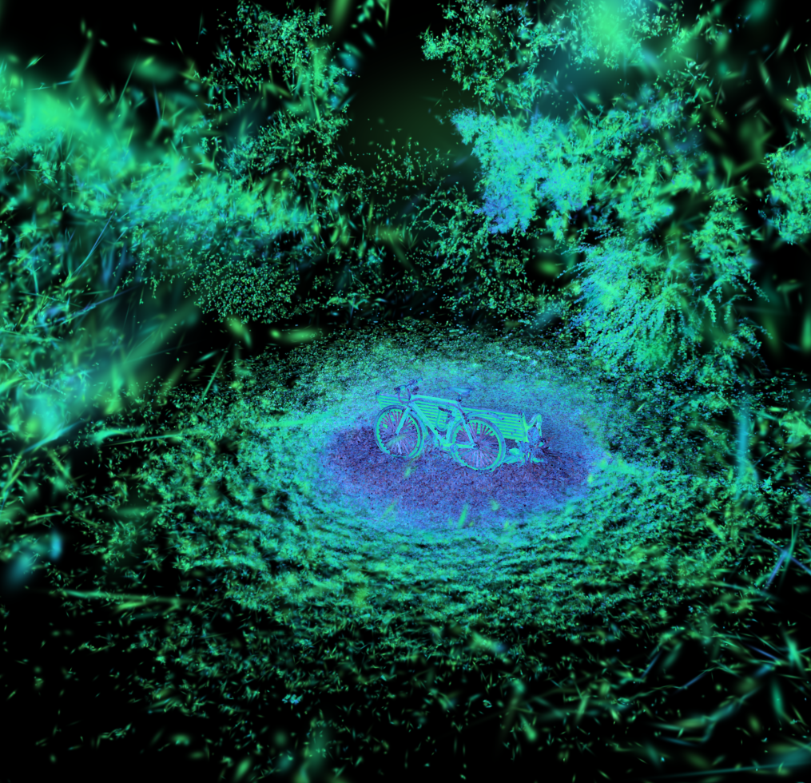

# Splat Uncertainty

A LichtFeld Studio plugin that estimates how well the training photos pin down each splat. It shows the result as heatmaps and lets you remove splats by uncertainty.

## Use

1. Open a trained project, or a splat file together with its dataset cameras.
2. **Compute uncertainty**: choose the model and a render width, then press *Compute uncertainty*.
3. **Heatmap**: pick a strategy, colour map, log scale and percentile range, then *Show heatmap*.
   - Magenta marks splats no training view sees.
   - The heatmap writes into the model's colours in memory. Press *Hide heatmap* (the same button) before saving the project.
4. **Remove by uncertainty**: choose the score (by default the heatmap strategy) and the rule (most uncertain percent, score at or above a value, or most certain percent).
   - The percentage bar starts at 0. Moving it hides the matching splats at once (a soft delete), and moving it back brings them back.
   - When at least one splat is hidden, **Apply Removal** appears. It deletes them from the model in place with LichtFeld's own splat delete, as one undo step, so Ctrl+Z restores them. *Reset* unhides everything.
   - A project opened from training stays a training project; no second model is created, because LichtFeld renders only the training model in that mode.
5. **Export** (optional) writes a PLY with every score as an extra `unc_<strategy>` attribute.

**While training runs** the panel is disabled and shows "Training is running. Pause or finish training to use Splat Uncertainty." When training starts, the plugin first hides the heatmap, unhides any splats it hid and cancels a running Fisher pass, so the trainer always gets the untouched model.

The same steps are available as plugin capabilities, for scripts and MCP: `splat_uncertainty.compute`, `.status`, `.heatmap` and `.remove`.

## Method

The plugin uses a block-diagonal Laplace approximation with Gauss-Newton curvature, which is the setting of PUP 3D-GS:

$$
F_i = \sum_{\text{views}} \sum_{p} J_{p,i}^\top J_{p,i},
\qquad J_{p,i} = \frac{\partial C_p}{\partial \theta_i}
$$

$$
\Sigma_i = \left( \frac{F_i}{\sigma^2} + \Lambda \right)^{-1}
$$

- $`\theta_i`$ is the splat's 10 parameters: position (3), log-scale (3), local rotation (3) and opacity logit (1).
- $`\sigma^2`$ is the pixel noise. By default it is the mean squared residual between the model's render and the photos.
- $`\Lambda`$ is a weak Gaussian prior. It keeps directions no view constrains finite. Its position term is given as a fraction of the scene scale.

The Fisher pass runs custom CUDA kernels, compiled at runtime with NVRTC through CuPy. They copy the LichtFeld FastGS conventions: EWA projection with 0.3 px dilation, pixel centres at +0.5, alpha clamped to [1/255, 0.999], and a transmittance cut at 1e-4. On the test scene the plugin's render reaches 30–37 dB PSNR against the photos.

Per pixel, a splat's colour Jacobian factors as $`\frac{\partial C}{\partial \alpha} \cdot \frac{\partial \alpha}{\partial u}`$, where $`u`$ is the splat's screen-space parameters (2D mean, conic, opacity). The kernel therefore accumulates exact per-pixel outer products in $`u`$ space with a warp reduction. It then maps them to the 10 parameters with the projection Jacobian (central differences in double precision). These are exact per-pixel outer products, not the "empirical Fisher" built from squared per-image gradients.

### Strategies

| Strategy | Score | Basis |
|---|---|---|
| Sensitivity (PUP 3D-GS) | −log det of the raw 6×6 position+scale Fisher | Hanson et al., *PUP 3D-GS*, CVPR 2025 |
| Posterior entropy | ½ log det of the 10×10 posterior covariance (D-optimality) | Laplace approximation; FisherRF (ECCV 2024), POp-GS (CVPR 2025) |
| Position std | √trace of the 3×3 position covariance (A-optimality) | POp-GS |
| Worst-axis position std | √(largest eigenvalue) (E-optimality) | optimal experimental design / POp-GS |
| Diagonal Fisher position std | diagonal-only approximation of the above | Jiang et al., *FisherRF*, ECCV 2024 |
| Relative position std | worst-axis std ÷ largest splat scale | derived here, not from a paper |
| Along-ray position std | std along the mean viewing direction (depth ambiguity) | derived here, not from a paper |
| Scale std | √trace of the log-scale covariance | derived here |
| Few observing views | number of views where the splat contributes | heuristic baseline |
| Narrow viewing baseline | mean resultant length of the viewing directions | heuristic baseline |

## Limitations

- **The scores rank splats; they are not calibrated error bars.** The block-diagonal approximation ignores coupling between splats, which makes it overconfident.
- **Parameter-space uncertainty has been reported to correlate weakly with actual error in new views.** See *Predictive Photometric Uncertainty in Gaussian Splatting*, arXiv 2603.22786 (2026). Treat floater removal as experimental, and check the result on held-out views.
- **The heatmap modifies the model's colours in memory until restored.** Restoring also happens when the plugin unloads.
- **Only an L2 photometric term is modelled, not LichtFeld's full training loss.** The curvature comes from a Gauss-Newton approximation of an L2 (Gaussian-noise) pixel loss, while training uses L1 + D-SSIM plus extra terms. Effects of what is left out:
  - Regularisers and auxiliary losses (opacity and scale regularisation, the bilateral grid's smoothness term, gradient and edge losses) add curvature, so leaving them out makes splats look **more** uncertain than the trained objective implies.
  - Appearance models (bilateral grid, exposure correction, PPISP) add parameters that can also explain pixel colour, so leaving them out makes splats, opacity especially, look **less** uncertain. The plugin also renders without them, which raises the noise estimate and scales every score by the same factor.
- **Removal assumes one splat node or the scene's node order.** With several splat nodes, the mask offset follows the scene's node order.
- **Removal doesn't update the scores.** After a removal the scores still describe the original fit; compute again for fresh ones.
- **Cameras are pinhole.** Lens distortion is ignored.

## Requirements

- NVIDIA GPU with CUDA 12.
- The plugin installs `cupy-cuda12x[ctk]` and `numpy` into its own environment. The `ctk` extra brings NVRTC and the CUDA headers as Python packages, so no system CUDA toolkit is needed; only an NVIDIA driver that supports CUDA 12.
- Tested on Windows 11 with an RTX 4090. Linux is untested.

## Development tools

The development scripts live in `../splat-uncertainty-devtools`, outside this folder so editing them does not hot-reload the plugin:

- an offline renderer check and a finite-difference Fisher check against a trained PLY and COLMAP dataset
- an MCP client for driving the app
- a heatmap gallery generator
